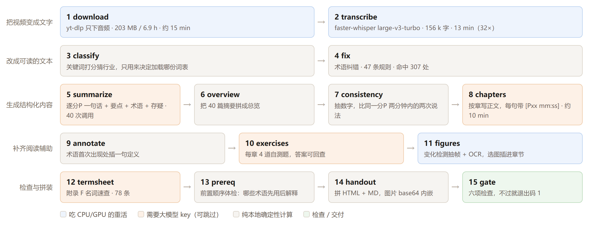
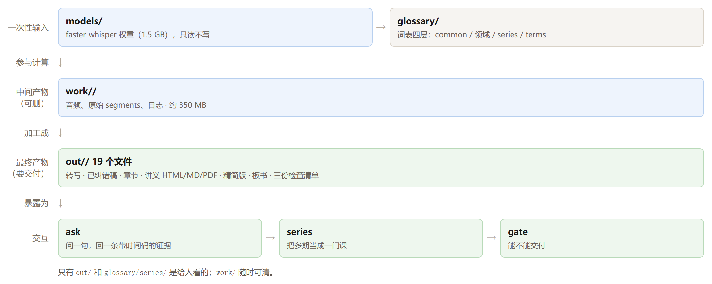
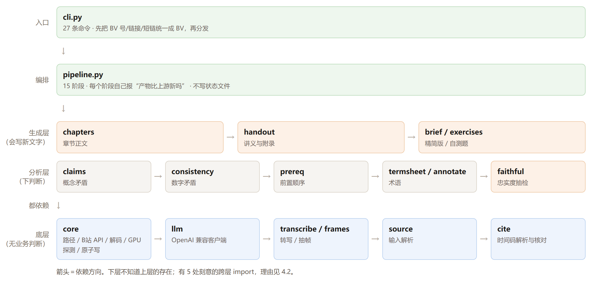
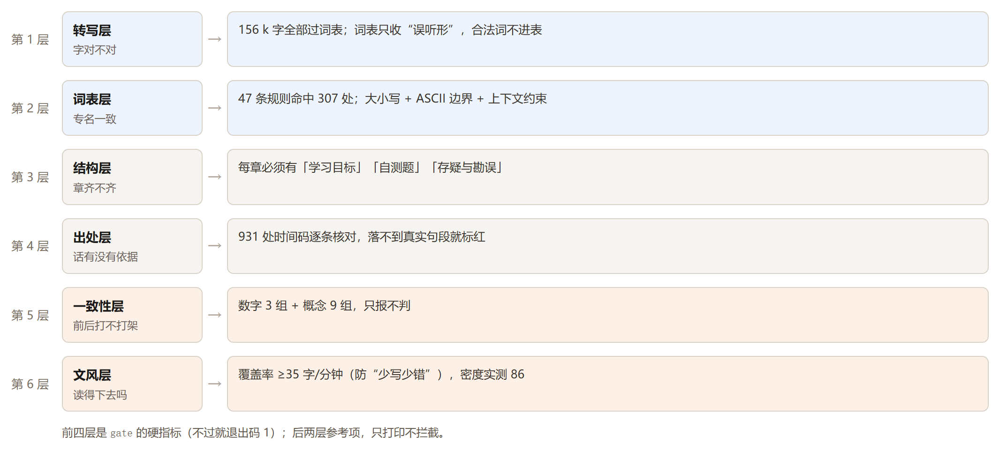

# 技术方案与代码架构（供 review）

> 版本：对应 `main` @ `099cf20`（tag `v1.0.1`）
> 规模：29 个 Python 文件、6,645 行、63 个单元测试、CI 4 job 全绿
> 本文档只讲**为什么这样做**和**哪里还不行**；命令用法见 [README](../README.md)，产物观感见 Releases。

---

## 0. 怎么读这份文档

如果只有 15 分钟，按这个顺序看：

1. **第 2 节**（链路）：知道数据从哪来到哪去，15 个阶段各自产出什么
2. **第 5 节**（十个决策）：每个决策都有实测依据和代价，**这是最值得你挑战的部分**
3. **第 8 节**（缺陷）：我列了 15 条，按正确性/鲁棒性/可维护性/可移植性分级
4. **第 9 节**（优化清单）：按 ROI 排序，含"不建议做"的三条

三处**我自己最没把握**的地方，建议重点看：

| 位置 | 为什么没把握 |
|---|---|
| 5.5 与 8.A1 | 讲义"忠实度"只有抽样结论（100 条里 2 条不支持、56 条"部分支持"），而"部分支持"到底算不算问题，取决于你对措辞强度的容忍度——我没有独立标注来校准 |
| 5.5 与 8.A2 | 概念矛盾检测精度约 60%，判定完全交给 LLM，我只有"人工看 9 组"这一个样本，没有第二个人复核 |
| 5.7 与 8.A6 | 附录 E 的 OCR 噪声只是"压下去"（几何过滤），不是根治；换一批视频很可能又冒出来 |

---

## 1. 项目要解决的问题，以及刻意不做的事

**要解决**：时长 30 分钟到 10 小时的中文长视频（公开课、讲座、长访谈、纪录片），看完太贵、跳着看又怕漏。目标产物不是"摘要"，而是**一份能当书读、能当资料查、能打印、每句话能回溯到原片某一秒的讲义**。

判据（也是 `gate` 的由来）：随机抽 20 条论断，能逐条点回原片并确认"讲者确实这么说过"。

**刻意不做**：

| 不做 | 理由 |
|---|---|
| 通用视频下载器 | 已饱和（yt-dlp + 一堆 GUI），不是差异化 |
| 又一个"视频转笔记"壳 | 2025 年就有 3.3k star 的项目，天花板在那儿 |
| 用 VLM 理解画面内容 | 8GB 卡上跑的 3B 模型会编数字，而数字是这份讲义的核心资产 |
| 短视频 / 实时 | 短内容不需要讲义；实时是另一套工程（流式 ASR + 前端） |
| 依赖 B 站字幕 | 实测不可用，见 5.1 |

---

## 2. 端到端链路（15 个阶段）



`python cli.py all <BV>` 依次跑下面这些阶段。`需要 key` 一列决定 `--no-llm` 时跳过谁。

| # | 阶段 | 干什么 | 产物 | 需要 key | 实测耗时（6.92h / 40 分P） |
|---|---|---|---|---|---|
| 1 | `download` | yt-dlp 下全部分P 音频（`--dl-only`，不加载模型） | `work/<bv>/p*.m4a` | 否 | 约 15 分钟（网络限速，203 MB） |
| 2 | `transcribe` | faster-whisper-large-v3-turbo（GPU fp16）转写 | `work/<bv>/segments.json` | 否 | **13 分钟**（28–32x 实时） |
| 3 | `classify` | 关键词投票判行业，决定加载哪本词表 | `out/<bv>/domain.json` | 否 | <1 秒 |
| 4 | `fix` | 术语纠错（47 条 obs 规则，带上下文约束） | `segments_fixed.json`、`changes.md`、`全课转写_已纠错.md` | 否 | <1 秒（307 处） |
| 5 | `summarize` | 每分P 一篇 150 字摘要 | `summaries/P01..P40.md` | **是** | 约 8 分钟 / 10 万 tokens |
| 6 | `overview` | 拼目录 + 逐P 摘要 | `总览.md` | 是 | <1 秒 |
| 7 | `consistency` | 抽"紧挨属性词的数字"，同分P 180 秒内比对 | `consistency.md/.json` | 否 | <1 秒 |
| 8 | `chapters` | 按分章切分写正文（四段式 / `--derive` 五段式） | `handout/ch*.md` | **是** | 约 25 分钟 / 16 万 tokens |
| 9 | `termsheet` | 每个术语一句话定义（优先原文定义，其次 LLM 改寫） | `termsheet.md/.json` | 是 | 约 2 分钟 |
| 10 | `annotate` | 术语首次出现处补括号注解（幂等） | 改 `ch*.md`、`annotate.json` | 否 | <1 秒 |
| 11 | `exercises` | 每章 4 道自测题，答案必须带出处 | 改 `ch*.md` | 是 | 约 3 分钟 |
| 12 | `figures` | 从已抽帧里挑图插进章节（无帧则跳过） | 改 `ch*.md`、`figures/` | 否 | <1 秒 |
| 13 | `prereq` | "先用了后解释"体检 | `prereq.md` | 否 | <1 秒 |
| 14 | `handout` | 拼 HTML/MD + 6 个附录（公式转 MathML、图片 base64 内嵌） | `讲义.html/.md` | 否 | 约 10 秒 |
| 15 | `gate` | 六项交付检查 | 终端输出、退出码 | 否 | <1 秒 |

补充：

- **`frames`（抽帧 + OCR）不在默认链路里**，因为它是唯一按帧计费时间的步骤（4–6 秒/帧，446 帧约 40 分钟）。用法：`cli.py frames --pages 5,14`，可后台跑；没有 `frames.json` 时 `figures` 自动跳过，讲义照出，只是少图。
- 每个阶段都能单独跑、都能重跑；`all` 用"产物是否比上游新"判断跳过，第二次跑 0.0 分钟（幂等已验证）。
- `--no-llm` 把 5/6/8/9/11 五个阶段标成跳过，产出"转写 + 纠错稿"这一半。

---

## 3. 数据模型



### 3.1 三个目录的职责

| 目录 | 内容 | 能否删 | 进仓库吗 |
|---|---|---|---|
| `work/<bv>/` | 音频 `p01.m4a`…、`segments.json`（原始）、`frames.json`、日志 | 能删（重跑会重建，但要重新下载+转写） | 否 |
| `out/<bv>/` | 全部交付物 + 中间产物 + 状态文件 | 能删（重跑约 40 分钟 + ¥1） | 否 |
| `models/` | whisper 权重（turbo 1.55 GB / medium 1.46 GB / small 464 MB） | 不能删 | 否（3.47 GB） |

### 3.2 `out/<bv>/` 文件清单

| 文件 | 谁写 | 谁读 | 说明 |
|---|---|---|---|
| `domain.json` | classify | fix / gate / handout | 行业 top3 + 置信比；`conf < 1.2` 时封面不显示领域标签 |
| `segments_fixed.json` | fix | 几乎所有下游 | 每句 `{start, end, text, text_fixed, page, lp, ns, cr}`；**`lp` 实测无用，见 5.3** |
| `changes.md` | fix | handout 附录 B、人工核对 | 307 条「改前 → 改后」 |
| `summaries/P*.md` | summarize | chapters（素材）、overview | 固定四块：一句话 / 要点 / 关键术语 / 存疑 |
| `总览.md` | overview | 人 | 目录表 + 40 篇摘要 |
| `consistency.md/.json` | consistency | handout 附录 D、gate | 3 组数值矛盾，全部人工复核为真 |
| `claims.json` | claims | handout 附录 D.2 | 1,554 条断言 → 9 组概念矛盾 |
| `termsheet.json` | termsheet | annotate、handout 附录 F | 78 条 `{term, def, src, ch, ctx}`，其中 34 条 `def == "—"`（原文没解释） |
| `handout/ch1..7.md` | chapters → annotate → exercises → figures（**四次改写同一批文件**） | handout | 顺序耦合，见 8.C3 |
| `chapters_state.json` | chapters | chapters（增量） | `{章键: 素材 md5}`，内容没变就跳过 |
| `annotate.json` | annotate | pipeline | `{"count": N}` 只作时间戳 |
| `figures.json` / `figures/*.jpg` | frames / figures | figures、handout | 帧的 OCR 文本 + 选中结果 |
| `板书.md` | frames | handout 附录 E（**直接读它，不读 frames.json**） | 这样中间帧可以删 |
| `prereq.md` | prereq | 人 | 78 个术语：42 个首次出现就带定义、9 个先出现后定义、23 个全文没定义、4 个「假定你已会」 |
| `讲义.html/.md` | handout | 人 | 最终交付物 |
| `精简版.md/.html` | brief | 人 | 4,441 汉字 |

### 3.3 词表的四层结构

```
glossary/
  common.tsv            通用技术词（任务←论物|论武 这种，全局生效）
  ai.tsv                领域词表（医学课就加载 med.tsv，见 domains.json）
  series/<bv>.tsv        这个视频专属的专名（自动长出来的，不进 git）
  terms/*.tsv            名词速查用的词典：规范词 | 别名 | 备注（只放"正确写法"）
  terms_override.tsv     人工修订：术语 | 一句话；**定义留空 = 这个词不是概念，删掉**
  _discovered.tsv        自动发现的候选（全 hyp，需人工升 obs）
```

三条硬规矩（写在 `glossary/README.md`）：

1. **只存"误听形"**，不存规范词的变体；
2. **不做跨语言替换**，不吞实义词（`论文` 只在前面是"下游/前置"时才改）；
3. **合法词不进表**：既是正常词又是误听的（`论文`、`VQ`）只能靠上下文约束，不能全局替换。

`fix` 只读 `common + series/<bv> + 领域` 三处；**故意不读 `terms/`**——那里是给人看的词典，不是纠错规则，混用会把正常词改坏。

---

## 4. 代码架构



### 4.1 分层

```
cli.py                命令表（27 条）+ argv 归一（链接/av/短链 → BV）
  └── pipeline.py     15 阶段的编排、幂等判断、--from/--only/--no-llm
        └── 业务模块   每个模块 = 一个阶段 = 一个 main()
              └── core.py      路径/API/音频解码/GPU/原子写/读文件
              └── llm.py       OpenAI 兼容客户端（重试、重试分类、token 统计）
```

依赖规则（**没有强制检查，靠自觉**）：业务模块只允许 import `core` 和 `llm`；互相 import 目前只有 5 处，都是有意的：

- `handout ← cite, consistency, termsheet`（拼附录时现算）
- `annotate ← prereq`（复用 mask/pattern/load_terms，保证"什么算正文"的口径一致）
- `series ← claims`（复用 `is_change()` 跳过"改口"）
- `gate ← fix, cite`（复用规则路径和时间码解析）

### 4.2 模块职责表

| 模块 | 行数 | 职责 | 关键函数 |
|---|---|---|---|
| `cli.py` | 158 | 命令分发、argv 归一、顶层异常 | `main()` `CMDS` |
| `pipeline.py` | 402 | 阶段编排、每个阶段的 `ch_*(bv, ctx)` 判断"要不要跑" | `STAGES` `run()` `check()` |
| `core.py` | 174 | 路径常量、B站 API（带退避）、音频解码、GPU 探测、原子写 | `api()` `decode()` `enable_cuda()` `segments_path()` `read_text()` `write_atomic()` |
| `llm.py` | 119 | OpenAI 兼容 chat，408/429/5xx 重试，空响应/HTML 响应也重试 | `LLM.chat()` `RetryableError` |
| `source.py` | 152 | 一切输入的归一化 + 视频元信息 | `parse()` `normalize_argv()` `meta()` |
| `transcribe.py` | 236 | 下载音频、GPU 真跑探测、逐分P 转写、写 srt | `probe()` `main()` |
| `classify.py` | 68 | 行业判定（关键词投票 + 置信比） | `score()` |
| `fix.py` | 174 | 术语纠错引擎：规则加载、边界/大小写、上下文约束 | `rule_paths()` `apply()` |
| `summarize.py` | 95 | 逐分P 摘要（12000 字分块） | `main()` |
| `overview.py` | 68 | 拼总览 | `main()` |
| `consistency.py` | 280 | 数字矛盾：抽取 `(实体, 属性, 值)`、同分P 180s 比对 | `extract()` `conflicts()` `_near()` |
| `claims.py` | 648 | 断言抽取（句式版 + LLM 版）、冲突判定、改口过滤 | `extract_llm()` `judge()` `confirm()` `dedupe()` |
| `cite.py` | 119 | `[Pxx mm:ss]` 解析 + 回查真实句段 | `parse()` `verify()` `annotate_html()` |
| `chapters.py` | 541 | 分章切分（编号/时间装箱）、正文生成（四段式/五段式）、增量 | `auto_split()` `make_material()` `write_chapter()` `_sig()` |
| `termsheet.py` | 281 | 名词速查：原文定义 + override + LLM 补写 | `build()` `fill_llm()` `apply_override()` |
| `annotate.py` | 171 | 幂等注解：先 strip 再按长词优先插入 | `strip()` `annotate()` |
| `exercises.py` | 158 | 出题 + 答案出处校验 + 三轮重试 | `ask()` `parse()` |
| `frames.py` | 356 | 抽帧（变化检测）、dHash 去重、RapidOCR、板书.md | `grab()` `ocr_frames()` `refine()` |
| `figures.py` | 212 | 选图（锚定出处 ±30s、小节去重）、插入图块 | `pick_chapter()` `nearest_cite()` |
| `prereq.py` | 315 | "先用了后解释"：mask 正文、找首次使用/定义 | `mask()` `find()` `scan()` |
| `handout.py` | 629 | 拼 HTML/MD：MathML、slug、附录 A–F、图片内嵌 | `md_to_html()` `build_appendix()` |
| `brief.py` | 207 | 精简版：六块骨架 + 一页地图 + 十条总纲 | `build()` `normalize()` `render()` |
| `ask.py` | 199 | BM25 检索（窗口化）+ 可选 LLM 回答 | `build()` `answer()` |
| `faithful.py` | 159 | 抽检：论断 vs 原文蕴含判定 | `evidence()` `judge()` |
| `series.py` | 252 | 跨期整合：合集 → 地图 / 重复概念 / 跨期冲突 | `season_of()` `fetch_season()` |
| `coldstart.py` | 245 | 猜听错的专名（编辑距离 + 词典） | `load_lexicon()` `candidates()` |
| `harvest.py` | 56 | 从摘要里回收"术语（转写为 X）"候选 | `main()` |
| `gate.py` | 146 | 六项检查 + 退出码 | `main()` `_need_chapters()` |

### 4.3 一次 `all` 的数据流

```
BV ──download──► p01..p40.m4a
        │
        └─transcribe─► segments.json ──fix──► segments_fixed.json ─┬─► summarize ─► summaries/ ─► overview
                                                                   ├─► consistency
                                                                   ├─► chapters ─► ch*.md ─┬─► annotate
                                                                   │                        ├─► exercises
                                                                   │                        └─► figures
                                                                   ├─► termsheet ─► termsheet.json ─► annotate / handout 附录 F
                                                                   ├─► prereq
                                                                   └─► handout ─► 讲义.html/md ─► gate
```

关键耦合：**`ch*.md` 被四个阶段依次改写**（chapters 生成 → annotate 插注解 → exercises 加题 → figures 插图）。好处是每一步都能单独关掉；坏处是顺序错、或者某一步重跑，就会互相打架（踩过两次，见 5.9）。

---

## 5. 十个关键决策

每条都按「问题 → 备选 → 选择 → 依据 → 代价」写。

### 5.1 完全不用 B 站自带字幕

- **问题**：字幕能省 90% 转写时间。
- **备选**：①用 AI 字幕 ②用 UP 上传字幕 ③自己转写。
- **选择**：③，全量本地 ASR。
- **依据**（实测两个不同 UP 的 40 分P 课程，共 80 个分P）：
  - 39/40 与 37/40 有 `ai-zh` 字幕，但**内容是别的视频**：P1 是英雄联盟解说、P2 是电视剧台词、P11 是行车 vlog、P16 是英文歌词；
  - 5 对分P 的字幕统计完全一致（P27&P32 都是 278 条 / 2261 字）→ 串号；
  - 覆盖率从 8% 到 869%，>90% 的只有 18–20 个分P；
  - 决定性验证：下 P1 音频自己转写，内容是"大家好我们的课程会设计视觉大模型的绝大多数内容…"——**音频对、字幕错**。
- **代价**：6.92 小时要 13 分钟 GPU（CPU 要 2 小时）。

### 5.2 GPU 探测：真跑 0.6 秒，而不是数设备

- **问题**：有卡但没装 CUDA 运行库时，程序要在第一次推理才崩。
- **备选**：①`ctranslate2.get_cuda_device_count()` ②`torch.cuda.is_available()` ③真跑一小段。
- **选择**：③——`probe(model, "cuda")` 用 `np.zeros(9600)`（0.6 秒静音）真跑一次并消费生成器，异常就回落 `cpu/int8` 并打印装包命令。
- **依据**：`get_cuda_device_count()` 返回 1，但第一次 encode 报 `Library cublas64_12.dll is not found`——**它只数设备、不加载 cublas**。这个 bug 本机永远测不出（我装齐了运行库），是陌生人第一次 clone 时撞到的。
- **代价**：启动多 0.6 秒。

### 5.3 纠错用"词表 + 上下文约束"，不用置信度

- **问题**：whisper 把 `下游任务` 听成 `下游论物`（本片 11 次）。
- **备选**：①`avg_logprob < -0.6` 筛可疑句再让 LLM 复核 ②词表替换 ③per-speaker 微调。
- **选择**：②。
- **依据**：①被数据否掉——10,800 句里 `avg_logprob` 最小是 **-0.266**，低于 -0.6 的 **0 条**。原因是 VAD 已经把噪声音频切干净，剩下的句子模型都很自信；"自信"和"正确"是两件事。③没有依据：同一主播同一个词 149 对 / 13 错（92% 对），错误集中在「下游/前置 + 任务」这个搭配上，是**解码器的词频偏置**，不是口音。
- **代价**：词表要人维护（本片 47 条 obs 规则）；字符层完全合法的"知识型错听"治不了（`清华河资源研究院` 应为"智源研究院"，只能标注）。

### 5.4 章节切分：分P 编号优先，否则按时间装箱

- **问题**：很多视频没有"第几章"的元信息（单集、直播回放、纪录片）。
- **选择**：`auto_split()` —— 分P 标题能解析出 ≥2 组数字前缀就按编号切；否则按音频时长切（单块 ≤1.6×25 分钟，超过先切片再按 1.4×25 分钟贪心装箱）。
- **依据**：早期版本只认编号，单集视频会退化成"1 章"；70 分钟的考研带背视频按时间切成 3 章后，gate 覆盖率 109 字/分，可读性正常。
- **代价**：时间切分的边界和内容边界经常不重合（一句话被切两半的概率不高，但存在）。

### 5.5 出处校验只验"落点"，语义靠抽检

- **问题**：模型写的每句话后面都有 `[P07 01:23]`，但那个时间码可能只是"附近有句相关的话"。
- **选择**：`cite.verify()` 只做**机械校验**：分P 存在、时间在时长内、±15 秒内有真实句段。语义层面的"这句话真的被支持吗"交给 `faithful` 抽样。
- **依据**：机械校验能 100% 覆盖（931/931），而且便宜（毫秒级）；语义校验一次要 1 次 LLM 调用，只负担得起抽样。
- **代价**：**这是目前最大的质量盲区**——我自己抽查时抓到过一整段"为什么需要它"是从上下文综合的，但因为有时间码，机械校验放过了。见第 9 节第 1 条。

### 5.6 覆盖率门槛：防"少写少错"

- **问题**：如果质量门只查"准确"，最优策略是写得越少越安全。
- **选择**：`gate` 增加一条**软门槛**：正文汉字 / 音频分钟 ≥ 35（笔记式 ≥18）。
- **依据**：教材密度 60–100 字/分钟，讲稿 200–300；早期版本 39 字/分，扩写后 86 字/分。设 35 是"不能比摘要还稀"的下限。
- **代价**：这条只能防"太薄"，防不了"水"（凑字数）。

### 5.7 视觉通道：720p + 变化检测 + 几何过滤

- **问题**：技术课的公式、代码、架构图常常不念出来。
- **备选**：①固定 1/10 秒抽帧 ②VLM 读画面 ③变化检测抽帧 + OCR。
- **选择**：③。
- **依据**：
  - 480p 下 OCR 出来是 `otch_31z=64` 这种糊字，**720p** 才能读出 `dataset=CIFAR10(root="./cifar10",...)`；
  - 帧差实测分布 p50=0.00 / p99=1.08 / 最大 6.71，所以阈值取 **2.5**（初版 6.0 只抓到 1–2 帧）；
  - 过滤**不能按词频**：静止的代码块每帧都一样，会被当"界面装饰"删掉。改成按**几何位置**丢（左侧 8% 是工程树、上边 4.5% 是菜单栏、下边 4% 是状态栏）。
- **代价**：仍有 IDE 界面噪声（`course_moco.py`、`Event Log`）；OCR 4–6 秒/帧，446 帧约 40 分钟——**这是全链路最慢的一步**。

### 5.8 注解幂等：strip → 长词优先 → 区间占位

- **问题**：`annotate` 会改 `ch*.md`；如果它把"术语（定义）"里的定义又当术语，就会套娃；`掩码` 和 `掩码重建` 首现位置重叠时会插成 `掩码（A）重建（B）`。
- **选择**：`annotate()` 每次先 `strip()` 收回上一轮的注解，再按**长词优先**排序插入，用 `occupied` 区间表跳过重叠位置。
- **依据**：连跑两次 `annotate`，7 个 `ch*.md` 的文件哈希完全一致（幂等的可证伪标准）。
- **代价**：`strip()` 只能收回"规范词 + 已知别名 + 大小写变体"，如果定义文本被模型改写过就收不回来（会留下重复注解）。

### 5.9 增量：内容签名，不是时间戳

- **问题**：改一个分P 不想重跑 7 章（16 万 tokens）。
- **选择**：`chapters._sig(pieces)` 对素材做 md5，写进 `chapters_state.json`；签名没变就跳过。
- **依据**：早期用 mtime 判断，结果 `touch` 一下转写文件就触发全量重写，而且用了默认密度（把 5 章都改短了）——已踩过，现在是"内容变了才重写 + 跳过时也记录签名"。
- **代价**：签名只覆盖章节素材，不覆盖提示词。**改提示词不会触发重写**，必须手动 `--force`。

### 5.10 精简版是重组，不是压缩

- **问题**：2.8 万字"精简"成 2 万字的摘要没有意义。
- **选择**：固定六块骨架（这一章在回答 / 核心结论 / 概念关系表 / 关键数字表 / 代码要点 / 易错点），逐章重写；再加一次汇总调用产出「一页地图」和「十条总纲」。
- **依据**：28,043 → 4,441 汉字（16%），阅读 1.7 小时 → 15 分钟；每条结论仍带 `[Pxx mm:ss]`，236 处可跳回。
- **代价**：细节必然丢（每章 500–650 字），「一页地图 / 十条总纲」是模型综合的、**没有时间码**，属于"读得爽但无法逐条核对"的部分。

---

## 6. 质量体系（分层）



质量检查不是一个 `gate`，而是六层，每层解决不同问题：

| 层 | 模块 | 查什么 | 覆盖面 | 实测结果 |
|---|---|---|---|---|
| 事实·字面 | `fix` | 专名听错（词表 + 上下文） | 全量 10,800 句 | 47 条 obs 规则，命中 307 处，残留 0 |
| 事实·数字 | `consistency` | 同分P 180 秒内、同一属性两个值 | 全量数字断言 | 3 组，人工复核**全部为真** |
| 事实·概念 | `claims` | 同一主体"是/不是/有 N 个"互斥 | 1,554 条断言 | 9 组，人工判断 5–6 组为真 |
| 引用 | `cite` | 时间码能否落到真实句段 | 931 处全覆盖 | 931/931 = 100% |
| 结构 | `prereq` | 先用了后解释 | 78 个术语 | 出现 ≥10 次仍无定义 = **0** |
| 语义 | `faithful` | 论断是否被原文支持 | **抽样** 100 条 | 支持 42 / 部分支持 56 / 不支持 2 |

`gate` 把上面几条合成一次交付判断：

| 项 | 判据 | 硬/软 |
|---|---|---|
| 章节齐全 | ≥1 章（<30 分钟）/≥2（<90）/≥3，且每章有「学习目标」或「这一段讲了什么」+「存疑与勘误」 | 硬 |
| 出处可核对 | ≥98% 时间码落到真实句段（±15s） | 硬 |
| 术语干净 | obs 规则的误听形残留 = 0 | 硬 |
| 前置顺序 | 出现 ≥10 次仍无定义 = 0 | 硬 |
| 覆盖率 | ≥35（笔记式 18）汉字/音频分钟 | 软（只提示） |
| 前后一致 | 数值冲突组数 | 软（只报数） |

---

## 7. 性能与成本

| 项 | 数值 | 备注 |
|---|---|---|
| 转写速度 | GPU turbo fp16 **28–32x** 实时；CPU small int8 3.5x、CPU medium 1.1x | 同一段 300 秒音频实测 |
| 全流程（6.92h 课程） | 约 40 分钟 | 转写 13 + 章节 25 + 摘要 8（部分可并行） |
| 抽帧 OCR | 4–6 秒/帧 | 446 帧 ≈ 40 分钟，**最慢**，可后台/可跳过 |
| token 消耗 | 约 61 万（讲义）/ 加精简版 4 万 | DeepSeek ≈ ¥1 |
| 显存 | turbo fp16 约 3 GB | 8 GB 卡有余量；OCR 走 CPU |
| 磁盘 | `work/` 698 MB（音频）；`out/` 约 8 MB；`models/` 3.47 GB | 音频最大，可删 |

瓶颈排序：**OCR > 转写 > 章节生成**。如果只优化一处，优化 OCR（换 PaddleOCR server 版或只对"画面变化大"的分P 抽帧）。

---

## 8. 已知缺陷与风险

分级：A 影响结论正确性，B 影响能否跑通，C 影响维护，D 影响移植。

### A. 正确性

| # | 问题 | 证据 | 影响 |
|---|---|---|---|
| A1 | `faithful` 只抽样（100/931），且"部分支持"占 56%——这个比例的含义没有被定义（是措辞更强？还是加了推断？） | 抽检结果 | 讲义可能有 5–10% 的句子"似是而非"，而 gate 是绿的 |
| A2 | `claims` 精度约 60%，主体切分靠正则；中文没有词边界，`batch size是256` 这种会把主体截成 `size` | 9 组人工复核 | 报出来的可能不是真矛盾，真矛盾也可能漏 |
| A3 | `consistency` 只看得见"紧挨着属性词的数字"，"维度就是 718" 这种数字在后的语序抓不到 | 设计限制 | 数值冲突召回偏低（本片 3 组，实际可能更多） |
| A4 | 领域分类器只对 AI/技术内容可靠：19 分钟时政视频被判成"美食与生活 1.29 / 编程 1.16" | 实测 | 影响纠错词表加载和封面标签；**已让风格判定不依赖它**，但词表仍受影响 |
| A5 | 中文同音错听（`智源研究院` → `清华河资源研究院`）字符层完全合法，词表治不了 | 实测残留 1 处 | 只能靠人读；`faithful` 也发现不了（它只看"是否被支持"，不看"是否听错"） |
| A6 | 附录 E 的 OCR 仍混 IDE 界面（`course_moco.py`、`Event Log`） | 渲染截图 | 读者要自己过滤，已声明"只当线索" |

### B. 鲁棒性

| # | 问题 | 现状 |
|---|---|---|
| B1 | 番剧 / 会员专享 / 需登录的源不支持（yt-dlp 被重定向到 bangumi，`Requested format is not available`） | 已捕获并给中文提示 + `--no-dl` 手放音频的退路 |
| B2 | 没有 LLM key 时 5 个阶段跳过，只剩"转写 + 纠错" | `--no-llm` 是显式选择；但 README 承诺的"跑一半"边界要写清（已写） |
| B3 | 单章输出会撞模型 8k token 上限被截断 | 已把 `target` 上限压到 10,000 字；仍可能丢尾（ch6 踩过） |

### C. 可维护性

| # | 问题 |
|---|---|
| C1 | `claims.py`（648）、`handout.py`（629）、`chapters.py`（541）三个文件偏大，单个函数最长近百行 |
| C2 | 没有类型注解、没有 mypy；错误用 `SystemExit` 表达，库函数抛异常、CLI 捕获——混用 |
| C3 | `ch*.md` 被四个阶段依次改写，顺序错了会互相破坏（踩过：annotate 排在 termsheet 前面导致速查表读到已注解文本） |
| C4 | 幂等逻辑分散在各模块的 `ch_*` 函数里，没有统一的"状态机"；`chapters_state.json` / `annotate.json` / 文件 mtime 三套机制并存 |
| C5 | 测试只覆盖纯函数（63 例），**没有 pipeline 级测试**（mock LLM 跑完整链路） |

### D. 可移植性

| # | 问题 |
|---|---|
| D1 | 只在 Windows 11 + 单张 4060/5060 级卡上验证；Linux 没有实跑（CI 只跑单元测试，不跑真实视频） |
| D2 | `av` 19 与 `faster-whisper` 1.2.1 有兼容史（`metadata_errors`），requirements 只 pin 到 `av>=14`，将来可能再撞 |
| D3 | 中文路径 / 控制台编码踩过 3 次（py 读文件、PowerShell here-string、cmd 注释），已修但同类问题会重现 |

---

## 9. 优化清单（按 ROI）

### 值得做

| # | 优化 | 为什么 | 工作量 | 验证方式 |
|---|---|---|---|---|
| 1 | **生成期约束出处**：让章节生成时只能引用"已存在的句 id"，而不是事后校验时间码 | 直接消掉 A1 的一半——现在"综合出来的句子 + 随手一个时间码"能过机器校验 | 2 天 | 抽 100 条论断，`faithful` 的"不支持"降到 0，"部分支持"降到 20% 以下 |
| 2 | **`claims` 主体走受限本体**：subject 只能从 `termsheet.json` + 术语表里选，选不到就丢弃 | A2 的根因是"主体是自由文本"，中文没有词边界 | 1 天 | 人工复核 20 组，精度 >80% |
| 3 | **OCR 只抽"讲授画面"**：先判定这一帧是 IDE/PPT/手写，再决定 OCR 策略 | A6 + 40 分钟瓶颈一起解 | 1 天 | 附录 E 里 IDE 行占比 <10% |
| 4 | **统一状态机**：把 15 个阶段的产物/签名写进 `out/<bv>/state.json`（或 sqlite） | C4，也让"重跑一定会跳过已完成"变成可测属性 | 1 天 | 连跑两次 `all`，第二次 0 调用、0 文件变更 |
| 5 | **pipeline 级测试**：mock LLM + 3 分钟合成视频，跑 `all` 断言产物齐全、gate 通过 | C5，也是防"改 A 坏 B"的唯一手段 | 1 天 | CI 里加一个 job |

### 待定（要先回答一个问题）

| # | 优化 | 先回答 |
|---|---|---|
| 6 | 讲义里嵌"问答入口"（每节末尾给 3 个可点的问法） | 读者是在"读"还是在"查"？两种产品的目录结构应该不同 |
| 7 | 章节密度自适应（按时长 60/90/150 字每分） | 密度和"讲清楚"没有线性关系，加长可能只是更啰嗦 |
| 8 | `series` 从 3 期扩到 50 期（跨期去重 + 修正表） | 50 期 × 13 分钟 = 11 小时机器时间，值不值取决于你多久换一门课 |

### 不建议做

| # | 优化 | 理由 |
|---|---|---|
| 9 | VLM 读画面替代 OCR | 3B int4 在 8GB 卡上会编数字，而数字是这份讲义的核心资产；OCR 至少"错得可见" |
| 10 | 打包成 pip 包 / Web 服务 | 现在的形态是"命令行 → 一份文件"，服务化要先回答"谁来为 GPU 时间付费" |
| 11 | 多语言 | ASR 已支持英文，但术语表、提示词、`claims` 的正则全部是中文假设，等于重做一遍 |

---

## 10. 测试与 CI

| 文件 | 例数 | 覆盖 |
|---|---|---|
| `tests/test_core.py` | 18 | `source.parse/normalize_argv`、`chapters.auto_split/time_split/_sig`、`cite.parse/stats`、`prereq.mask`、`ask.BM25/tokens/expand`、`gate._need_chapters`、`series.concept_key` |
| `tests/test_fixes.py` | 16 | `fix` 规则大小写/边界/纯数字/BOM/上下文、`consistency` 除零与量级、`gate` 残留过滤、`handout` slug 唯一性与行内代码保护、`brief.normalize`、`claims` 缺字段、`prereq` 删除名单 |
| `tests/test_outputs.py` | 23 | MathML 渲染、表格/代码块存活、`figures` 两种 OCR 形状、`termsheet.clean`、`exercises.parse`、`coldstart` 打分、`chapters.strip_fence` |
| `tests/test_claims.py` | 6 | 主体含空格、否定尾、比较值截断、疑问句、series 按 kind 分组、annotate 别名收回 |

**没覆盖的**：LLM 调用路径（除 mock）、pipeline 编排、真实网络（B 站 API）、`frames` 的抽帧逻辑、`handout` 的附录组装。

CI：`.github/workflows/tests.yml`，ubuntu + windows × Python 3.11/3.12，只装 `numpy/pillow/markdown/latex2mathml`（重依赖都是函数内 import），跑 `unittest discover` + `compileall`。

陌生人复现记录（README 有完整表）：无 GPU 轮子 8.1 分钟、装齐轮子 2.1 分钟、修掉重复加载后 1.2 分钟，三次都是 gate 6/6。

---

## 11. 代码地图：想改什么看哪里

| 想改 | 看这里 |
|---|---|
| 输入形态（又一种链接格式） | `vsummary/source.py: parse()` |
| 转写模型 / 参数（beam、VAD、语言） | `vsummary/transcribe.py: main()` |
| 纠错规则格式 / 边界策略 | `vsummary/fix.py: _is_ascii_word()` `apply()` |
| 章节提示词（四段式 / 五段式） | `vsummary/chapters.py: TEXTBOOK / DERIVE / TALK` |
| 分章策略 | `vsummary/chapters.py: auto_split()` `time_split()` |
| 断言正则 / 冲突判定 | `vsummary/claims.py: RULES / judge() / confirm()` |
| 数值抽取规则 | `vsummary/consistency.py: RULES` |
| 附录版式 / CSS / 打印样式 | `vsummary/handout.py: CSS` `build_*()` |
| 抽帧阈值 / OCR 过滤 | `vsummary/frames.py: THR / refine()` |
| 选图规则 | `vsummary/figures.py: pick_chapter()` |
| gate 判据 | `vsummary/gate.py: main()` |
| 阶段顺序 / 跳过逻辑 | `vsummary/pipeline.py: STAGES / ch_*()` |
| 词表加载路径 | `vsummary/fix.py: rule_paths()`（唯一入口） |

---

## 12. 附录


### 12.1 命令表（27 条：24 个子命令 + `all` / `check` / `test`）

`all` `transcribe` `classify` `fix` `harvest` `summarize` `overview` `consistency` `claims` `cite` `coldstart` `prereq` `termsheet` `frames` `chapters` `annotate` `figures` `exercises` `handout` `brief` `ask` `faithful` `series` `gate` `check` `test`

（`frames` 不在 `all` 的默认阶段里；`all --dry-run` 会显示哪些阶段要跑。）

### 12.2 产物目录树（精简）

```
out/BV1E9U8BBEvZ/
├── 讲义.html            1.6 MB，单文件，111 页
├── 讲义.md              39,053 汉字（正文 35,844 + 附录）
├── 精简版.md/.html      4,441 汉字
├── 全课转写_已纠错.md   123,105 汉字，每句带深链
├── 总览.md              100 KB
├── 板书.md              446 段 OCR
├── changes.md           307 条改前→改后
├── consistency.md/.json 3 组数值矛盾
├── claims.json          1,554 条断言 / 9 组
├── termsheet.md/.json   78 术语 / 34 未定义
├── prereq.md            78 术语 / 23 未解释
├── handout/ch1..7.md    正文源文件（被四个阶段改写）
├── summaries/           40 篇
├── figures/             15 张（插进正文的）
└── style.json / domain.json / chapters_state.json / annotate.json
```

### 12.3 Review 建议清单

如果让我提 review 意见，我会先问这五个：

1. **5.5 的取舍对不对**：出处只验落点、语义靠抽样——你接受"gate 全绿但有 5% 的句子是综合出来的"吗？如果不接受，就要做第 9 节第 1 条。
2. **5.6 覆盖率门槛的数值**：35 字/分是"比摘要厚"的下限，教材是 60–100。现在是 86。要不要继续往 100 推？
3. **8.A2 精度 60% 的概念矛盾**该不该出现在交付物里？现在是"报 9 组、注明可能误报"。另一种做法是阈值提高、只报 3–4 组最确定的。
4. **C3 的顺序耦合**（四个阶段改写同一批文件）是设计缺陷还是可接受的简单？替换方案是"每阶段产出独立文件、handout 时合并"，但要改 4 个模块。
5. **要不要做服务化**（第 9 节第 10 条）：现在是"一个人 + 一张卡 + 一条命令"，如果目标用户是"每次看长视频都想用"，命令行就够；如果目标是"别人也能用"，那要先解决 GPU 时间的归属。
